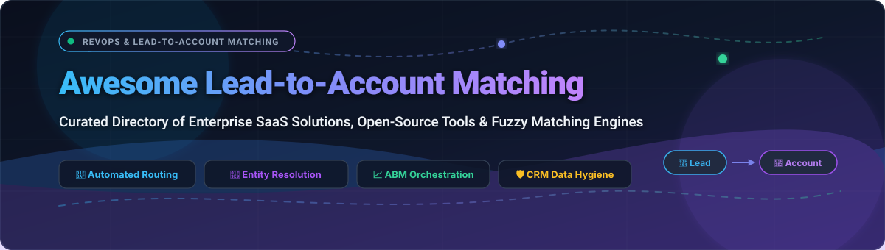

# 🎯 Awesome Lead-to-Account Matching [](https://awesome.re)

<p align="center">
  <a href="https://github.com/ishandutta2007/Awesome-Awesome-Awesome"></a><a href="https://discord.gg/jc4xtF58Ve"></a>
  <a href="https://github.com/ishandutta2007/Awesome-Lead-To-Account-Matching/stargazers"></a>
  <a href="https://github.com/ishandutta2007/Awesome-Lead-To-Account-Matching/network/members"></a>
  <a href="https://github.com/ishandutta2007/Awesome-Lead-To-Account-Matching/issues"></a>
  <a href="https://github.com/ishandutta2007/Awesome-Lead-To-Account-Matching/blob/main/LICENSE"></a>
  <a href="https://github.com/ishandutta2007"></a>
</p>

<p align="center">
  
</p>

> 🚀 **A curated directory of SaaS platforms, open-source libraries, and fuzzy matching engines for automated Lead-to-Account (L2A) matching, B2B lead routing, entity resolution, and CRM data hygiene.**

---

## 📑 Table of Contents

- [📊 Sector Overview & Market Dynamics](#-sector-overview--market-dynamics)
- [🏢 SaaS & Enterprise Platforms](#-saas--enterprise-platforms)
- [💻 Open-Source GitHub Projects](#-open-source-github-projects)
- [🧩 Architecture & Framework Stacks](#-architecture--framework-stacks)
- [🤝 How to Contribute](#-how-to-contribute)
- [💖 Support](#-support)
- [⭐ Star History](#-star-history)
- [⚖️ Disclaimer](#️-disclaimer)

---

## 📊 Sector Overview & Market Dynamics

The global **Lead-to-Account (L2A) matching and Revenue Operations (RevOps) orchestration market** is estimated at **$2.4 Billion in 2026** and projected to surpass **$5.8 Billion by 2031** (growing at a ~19.5% CAGR), accelerated by the rise of Account-Based Marketing (ABM), AI-driven buyer group detection, and strict CRM data quality mandates.

Market dynamics display **moderate fragmentation with strong core consolidation**: While mega-suite CRM platforms like **Salesforce** and data aggregators like **ZoomInfo** anchor high enterprise market share, specialized routing engines (e.g., LeanData, Chili Piper) and modern open-source entity resolution frameworks (e.g., Splink, Dedupe, n8n) drive intense continuous innovation across mid-market and self-hosted environments.

---

## 🏢 SaaS & Enterprise Platforms

The table below lists leading SaaS products for automated Lead-to-Account matching, sorted in descending order by company scale (market capitalization or valuation).

| 🏢 Platform | 💰 Company Scale (Valuation / Revenue) | 🏷️ Starting Price | 🎁 Free Tier / Free Trial Limits | 🔍 Core Matching & Routing Features |
| :--- | :--- | :--- | :--- | :--- |
| **[Salesforce Match Engine](https://help.salesforce.com/s/articleView?id=sales.matching_rules_standard_leads_on_accounts_rule.htm&type=5)** | ~$280B Market Cap (~$38B Annual Rev) | **$25/user/month** (Starter Suite) | **30-day free trial**; full access up to 2 active users & 2,500 contacts, no credit card required | Native matching rule engine; fuzzy string matching (Levenshtein, Jaro-Winkler, acronyms), website and email domain normalization, duplicate management. |
| **[ZoomInfo Complete](https://www.zoominfo.com/)** | ~$4.2B Market Cap (~$1.2B Annual Rev) | **$14,995/year** (Advanced Tier) | **14-day free trial**; capped at 25 export credits & single-seat access | Enterprise B2B data enrichment waterfall, domain-level account resolution, buying group intelligence, automated CRM record enrichment. |
| **[Demandbase Orchestration](https://www.demandbase.com/)** | ~$3.2B Valuation (~$300M ARR) | **$24,000/year** (ABM Core Tier) | **No free-forever plan**; custom **14-day sandbox trial** on request for up to 500 company domain audits | Complete ABM orchestration, multi-field fuzzy lead-to-account linking, account intent qualification, lead-to-opportunity mapping. |
| **[LeanData](https://www.leandata.com/)** | ~$1.2B Valuation (~$95M ARR) | **$39/user/month** (Routing Essentials) | **14-day free trial**; access limited to sandbox environment with up to 1,000 test lead routing records | Recognized category leader; multi-variable fuzzy logic matching (95%+ accuracy), visual drag-and-drop lead routing, automated conversion, audit trails. |
| **[Chili Piper Distro](https://www.chilipiper.com/)** | ~$625M Valuation (~$45M ARR) | **$30/user/month** (Distro plan) | **14-day free trial**; includes unlimited routing simulations for up to 5 test seats | Instant lead-to-account matching, dynamic round-robin routing, automated rep assignment based on territory, SLA adherence, and calendar booking. |
| **[RingLead](https://www.ringlead.com/)** *(ZoomInfo)* | ~$450M Valuation (Acquired by ZoomInfo) | **$12,000/year** (Cleanse + Match Tier) | **14-day guided proof-of-concept trial**; limited to 1,000 record scan & matching diagnostics | Complete CRM data orchestration, automated fuzzy deduplication, multi-source enrichment normalization, and lead-to-account assignment rules. |
| **[Leadspace](https://www.leadspace.com/)** | ~$350M Valuation (~$35M ARR) | **$25,000/year** (GTM Intelligence Base) | **No free-forever plan**; **14-day sandbox pilot** limited to 2,500 test account/lead records | Customer Data Platform (CDP) for B2B, AI-driven entity resolution, buyer profile scoring, graph-based account hierarchy discovery. |
| **[Openprise](https://www.openprise.com/)** | ~$220M Valuation (~$25M ARR) | **$24,000/year** (Data Automation Suite) | **14-day sandbox access**; limited to 5 automation bot executions and 2,000 processed records | No-code RevOps automation, API factory, multi-vendor data enrichment waterfalls, automated lead matching, routing, and record merging. |
| **[Full Circle Insights](https://www.fullcircleinsights.com/)** | ~$80M Valuation (~$15M ARR) | **$18,000/year** (Matchmaker Base) | **14-day sandbox trial**; restricted to single Salesforce sandbox org & 1,000 matched leads | 100% native Salesforce lead-to-account matching, conversion, funnel metrics attribution, engagement rating, tie-breaking rule prioritization. |
| **[CaliberMind](https://calibermind.com/)** | ~$45M Valuation (~$8M ARR) | **$18,000/year** (RevOps Analytics Tier) | **14-day free trial**; limited to 2 data source connectors and 5,000 processed events | Revenue attribution engine, B2B customer journey mapping, automated identity resolution linking anonymous leads to target account hierarchies. |

---

## 💻 Open-Source GitHub Projects

Explore top-rated open-source projects for building custom lead-to-account matching workflows, entity resolution pipelines, fuzzy string comparisons, and self-hosted CRM routing. Projects are sorted in descending order by **GitHub Stars_Count**.

| 📦 Repository & Project | ⭐ Stars_Badge | 🛠️ Technology | 📝 Description & L2A Capability |
| :--- | :--- | :--- | :--- |
| **[n8n](https://github.com/n8n-io/n8n)** | [](https://github.com/n8n-io/n8n/stargazers) | TypeScript / Node.js | Fair-code workflow automation tool. Easily orchestrates custom lead-to-account workflows: email domain parsing, CRM lookups, fuzzy matching, and Slack notifications without vendor lock-in. |
| **[Odoo](https://github.com/odoo/odoo)** | [](https://github.com/odoo/odoo/stargazers) | Python / JavaScript | Leading open-source business suite & CRM with automated partner lead assignment, automated lead scoring, and customer account association mechanics. |
| **[Apache Airflow](https://github.com/apache/airflow)** | [](https://github.com/apache/airflow/stargazers) | Python | Programmatic data pipeline orchestrator. Ideal for scheduled enterprise batch deduplication, CRM sync, and multi-step lead-to-account matching workflows. |
| **[ERPNext](https://github.com/frappe/erpnext)** | [](https://github.com/frappe/erpnext/stargazers) | Python / JavaScript | 100% open-source ERP & CRM suite featuring customizable lead conversion rules, automated lead-to-customer linking, and contact management. |
| **[Prefect](https://github.com/PrefectHQ/prefect)** | [](https://github.com/PrefectHQ/prefect/stargazers) | Python | Modern workflow orchestration engine for resilient data pipelines, real-time event-driven webhook processing, and lead matching ETL jobs. |
| **[Dagster](https://github.com/dagster-io/dagster)** | [](https://github.com/dagster-io/dagster/stargazers) | Python | Cloud-native data orchestrator designed for software-defined data assets; models CRM accounts and leads as versioned assets with data-quality assertions. |
| **[Debezium](https://github.com/debezium/debezium)** | [](https://github.com/debezium/debezium/stargazers) | Java | Open-source distributed platform for Change Data Capture (CDC). Streams real-time lead and account database changes to instantly trigger matching microservices. |
| **[OpenRefine](https://github.com/OpenRefine/OpenRefine)** | [](https://github.com/OpenRefine/OpenRefine/stargazers) | Java | Battle-tested data cleansing and transformation powerhouse with built-in clustering algorithms (fingerprint, ngram-fingerprint, Levenshtein, PPM) for entity deduplication. |
| **[FuzzyWuzzy](https://github.com/seatgeek/fuzzywuzzy)** | [](https://github.com/seatgeek/fuzzywuzzy/stargazers) | Python | Standard fuzzy string matching library in Python using Levenshtein distance to calculate differences between company names, street addresses, and domains. |
| **[Apache Camel](https://github.com/apache/camel)** | [](https://github.com/apache/camel/stargazers) | Java | Versatile open-source enterprise integration framework with 300+ components to connect enterprise CRMs, event queues, and lead routing pipes. |
| **[Apache NiFi](https://github.com/apache/nifi)** | [](https://github.com/apache/nifi/stargazers) | Java | Robust visual dataflow system capable of ingesting raw inbound leads, extracting domains, matching against account databases, and writing updates to CRMs. |
| **[Dedupe](https://github.com/dedupeio/dedupe)** | [](https://github.com/dedupeio/dedupe/stargazers) | Python | Machine-learning-powered deduplication and record linkage library using active learning to learn optimal weights across company names, emails, and phone numbers. |
| **[RapidFuzz](https://github.com/maxbachmann/RapidFuzz)** | [](https://github.com/maxbachmann/RapidFuzz/stargazers) | C++ / Python | Ultra-fast fuzzy string matching library implementing Levenshtein, Jaro-Winkler, and token sort metrics; orders of magnitude faster than standard implementations. |
| **[Splink](https://github.com/moj-analytical-services/splink)** | [](https://github.com/moj-analytical-services/splink/stargazers) | Python / DuckDB / Spark | Highly scalable probabilistic record linkage tool using the Fellegi-Sunter methodology; handles millions of lead and account records across DuckDB, SQLite, or Apache Spark. |
| **[Corteza CRM](https://github.com/cortezaproject/corteza)** | [](https://github.com/cortezaproject/corteza/stargazers) | Go / Vue.js | 100% open-source low-code alternative to Salesforce with native lead qualification, account conversion rules, and configurable record relationships. |
| **[Zingg](https://github.com/zinggAI/zingg)** | [](https://github.com/zinggAI/zingg/stargazers) | Java / Scala / Python | Open-source ML entity resolution tool built on Apache Spark; performs fuzzy matching, blocking, and identity clustering across massive customer databases. |
| **[Python Record Linkage Toolkit](https://github.com/J535D165/recordlinkage)** | [](https://github.com/J535D165/recordlinkage/stargazers) | Python | Comprehensive library for record linkage and entity resolution with standard indexing techniques, classifiers, and similarity comparison algorithms. |
| **[CSV Dedupe](https://github.com/dedupeio/csvdedupe)** | [](https://github.com/dedupeio/csvdedupe/stargazers) | Python | Command-line utility powered by Dedupe for deduplicating and matching lead/account CSV files using interactive active learning prompts. |

---

## 🧩 Architecture & Framework Stacks

Building a custom, data-sovereign lead-to-account matching infrastructure? Here are proven open-source reference patterns:

```
[Inbound Lead (Form/Webhook)]
            │
            ▼
   ┌─────────────────┐
   │    n8n / NiFi   │ ◄─── Ingestion, Email Domain Parsing & Filtering
   └────────┬────────┘
            │
            ▼
   ┌─────────────────┐
   │ RapidFuzz/Splink│ ◄─── Multi-Field Fuzzy Match against Master Account DB
   └────────┬────────┘
            │
      ┌─────┴────────────────┐
      ▼                      ▼
[Exact Match Found]   [Probabilistic Match / Tie-Breaker]
      │                      │
      ▼                      ▼
  Assign Account         Trigger RevOps Review / Smart Routing
      │                      │
      └───────────┬──────────┘
                  ▼
         ┌─────────────────┐
         │ CRM / Database  │ (Salesforce / Corteza / Odoo / ERPNext)
         └─────────────────┘
```

- **Domain Normalization**: Strip common public email domains (`gmail.com`, `yahoo.com`, `outlook.com`) to prevent false-positive grouping.
- **Fuzzy Company Matching**: Pair phonetic algorithms (Double Metaphone, Soundex) with token ratio matching (`RapidFuzz`) to reconcile abbreviations (e.g., `IBM` vs `International Business Machines`).
- **Probabilistic Scoring**: Apply **Splink** or **Dedupe** to combine multiple weak signals (phone area code, state/city, domain prefix, IP company detection) into a high-confidence match score.

---

## 🤝 How to Contribute

We welcome additions, corrections, and tool submissions from the RevOps, SalesOps, and engineering community!

1. 🍴 **Fork the repository**
2. 🌿 **Create a feature branch** (`git checkout -b add-tool-name`)
3. ✍️ **Update `README.md`**: Follow the established table format with accurate pricing, scale metrics, or Stars_Badges
4. 🚀 **Commit and push your changes** (`git commit -m "Add ToolName to SaaS directory"`)
5. 📬 **Submit a Pull Request** with a concise explanation

⭐ Don't forget to star the repo if you find this directory valuable!

---

## 💖 Support

Thank you for exploring and utilizing **Awesome Lead-to-Account Matching**! If you find this curated resource helpful for your RevOps strategy, pipeline architecture, or data engineering work, please consider supporting the project:

- ⭐ **Star this repository** to help others discover it!
- 🍴 **Fork and contribute** by submitting new tools or refining entries.
- 📢 **Share with colleagues** in your RevOps, SalesOps, or Data Engineering networks.
- ☕ **Buy me a coffee**: If this project brought value to your workflow, support ongoing maintenance and research on my [GitHub Sponsors Dashboard](https://github.com/sponsors/ishandutta2007)!

---

##  Star History
[](https://star-history.dera.page/#ishandutta2007/Awesome-Lead-To-Account-Matching&type=date&legend=top-left)

---

## ⚖️ Disclaimer

- This repository is a community-curated, independent directory. Company names, logos, and trademarks belong to their respective owners.
- Listed pricing, valuations, and free tier parameters reflect publicly available tier information as of 2026 and are subject to vendor updates.
- Organizations deploying matching pipelines must ensure strict compliance with applicable privacy regulations (GDPR, CCPA) and CRM security protocols.

---

<p align="center">
  <b>Built with ❤️ for Revenue Operations, Marketing Ops, and CRM Engineers worldwide.</b>
</p>
